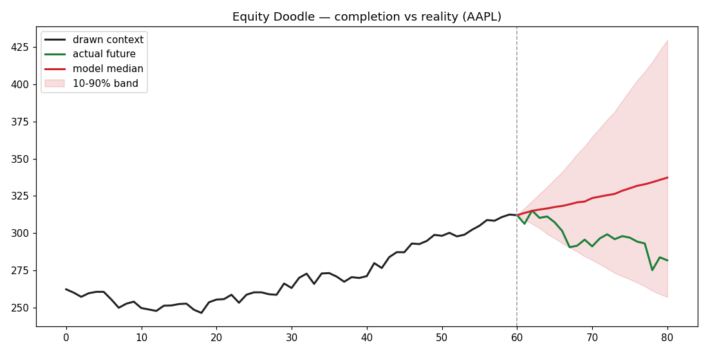

# Equity Doodle ✏️📈

**Draw the start of a chart — let the AI doodle the rest.**

Equity Doodle is a case-study project that frames stock-chart "completion" as a
time-series forecasting problem: the segment you draw is the model's **input
context window**, and the continuation it sketches is the **forecast horizon**.

A single *global* model is trained across ~530 liquid assets — equities, ETFs,
indices, futures, crypto, FX, commodities, rates — with daily history back to
1980 plus hourly and 15-minute intraday panels, so it learns the general
"grammar" of price paths rather than memorizing one ticker. The trained network ships as a ~1 MB
ONNX file and runs **entirely in your browser**: the deployed app is a static
site with no backend, and nothing you draw ever leaves the page.

> ⚠️ **This is an educational experiment, not a trading system.** See the
> [Disclaimer](#-disclaimer) below. It is not expected to be profitable, and
> that is fine — the goal is to study the modeling and product idea end-to-end.

---

## How it works

```
        you draw this                    the model completes this
   ┌───────────────────────┐        ┌─────────────────────────────┐
   price path (context)            quantile "fan" of continuations
   └───────────────────────┘        └─────────────────────────────┘
            │                                      ▲
            ▼                                      │
   log-returns ─► z-score ─► N-HiTS (ONNX, in-browser) ─► calibrated fan ─► rebuild price
```

1. **Data** — daily closes for the asset universe via `yfinance` (1980 →),
   plus hourly (≤730 d) and 15-minute (≤60 d) intraday panels pooled into the
   same training set (see `config.INTRADAY`).
2. **Features** — prices are converted to **log-returns** (stationary and
   comparable across tickers), then **z-scored per window**, so an arbitrary
   hand-drawn chart at any price scale can be fed in directly.
3. **Model** — a global **N-HiTS** network with **quantile regression**, so we
   get a probabilistic "fan" of completions rather than a single line. N-HiTS
   won an honest bake-off (`scripts/compare_models.py`) against TiDE variants
   on out-of-sample pinball loss and coverage (a LightGBM baseline is also
   available: `python scripts/compare_models.py lightgbm`).
4. **Calibration** — raw quantile fans are systematically overconfident (the
   nominal 10–90% band covered only ~60% of realized moves), so the fan is
   widened by a conformal-style factor fit on held-out data
   (`scripts/calibrate.py`) until the 80% band covers ~80%.
5. **Reconstruct** — predicted returns are rescaled by the drawn window's own
   volatility and integrated back into a price path, starting from the last
   point you drew.
6. **Inference** — the network is exported to ONNX (`scripts/export_onnx.py`)
   and executed client-side with ONNX Runtime Web. Horizons longer than the
   network's 20-bar output chunk use a batched Monte-Carlo autoregressive
   rollout, exactly like the Python reference implementation.

## Time-scale invariance

Equity Doodle is built to be **time-scale invariant** — you can train on any
resolution and draw at any resolution (intraday, daily, weekly) at any price
scale. Three mechanisms make that work:

1. **Integer index, return space** — the model forecasts log-returns on a plain
   integer index, so the calendar never enters.
2. **Per-window z-scoring** — the drawn window is normalized to zero-mean /
   unit-variance before the model sees it, then predictions are rescaled by the
   window's own volatility. This removes the volatility-scale dependence (daily
   vs weekly magnitudes) and means a jagged doodle yields a jagged completion.
3. **Multi-scale training** — each daily series is aggregated into block-sum
   returns at scales k = 1, 2, 3, 5, 10, 21 bars, so one global model learns the
   shape of price paths across resolutions.

This makes it *scale-robust*; perfect invariance is impossible because the
statistical structure of returns genuinely differs by scale — a real finance
fact, not a bug.

## Results (honest, out-of-sample)

Held-out tail of every series, forecast origins strided across time
(`scripts/backtest.py`, `scripts/compare_models.py`):

| model     | scale  | dir. acc | pinball ↓ | 10–90% coverage |
|-----------|--------|---------:|----------:|----------------:|
| TiDE      | daily  | 0.494    | 0.0232    | 0.558           |
| TiDE (big)| daily  | 0.496    | 0.0236    | 0.531           |
| **N-HiTS**| daily  | 0.499    | **0.0224**| 0.588 → **0.78 calibrated** |
| **N-HiTS**| weekly | 0.551    | **0.0436**| 0.646 → **0.83 calibrated** |

Directional accuracy sits at a coin flip — as it should for liquid markets.
The model's value is the *shape and width* of its uncertainty, not its
direction. The wide fan is the finding: it is the efficient-market intuition,
drawn. See the [about page](web/about.html) for the full argument.



## Repository layout

```
equity_doodle/       research library (data, features, model backends, forecast)
scripts/             download / train / backtest / bake-off / calibrate / export
web/                 the deployed product — static site, in-browser ONNX inference
models/, data/       local artifacts (gitignored, regenerated by the scripts)
```

## Reproduce the pipeline

```bash
python -m venv .venv && source .venv/bin/activate
pip install -r requirements.txt

python scripts/download_data.py     # 1. daily data, free, no API key
python scripts/train.py             # 2. train the global model (GPU if available)
python scripts/backtest.py          # 3. honest out-of-sample backtest
python scripts/compare_models.py    # 4. (optional) re-run the bake-off
python scripts/calibrate.py         # 5. (optional) re-fit the calibration factor
python scripts/export_onnx.py       # 6. export web/model.onnx + parity check
python scripts/export_challenges.py # 7. regenerate the game's challenge bank
```

## Beat the Model 🎯

The site also ships a repeatable game (`web/game.html`): a real historical
window from the asset universe is shown with the ticker hidden, you *draw*
what happens next, and the reveal overlays what actually happened plus the
model's calibrated fan — scored (average per-bar miss, you vs. the model's
median, plus band coverage). The challenge bank is static JSON generated by
`scripts/export_challenges.py` from the cached price panel, so the game runs
with no backend too.

The drawing board also has one-click **classic-pattern presets** (head &
shoulders, double top, bull flag, cup & handle, an honest random walk) and a
**"roll another future"** button that draws fresh sample paths from the same
forecast, leaving ghosts of earlier rolls — many plausible futures accumulating
is the uncertainty argument, made visceral.

## Run the web app

The app is pure static files — any file server works:

```bash
python -m http.server 8000 --directory web
# open http://localhost:8000
```

Deploys as-is to any static host (Vercel config included in `web/`).

## ⚖️ Disclaimer

Equity Doodle is provided for **educational and research purposes only**. It is
**not financial, investment, trading, or any other kind of advice**. Nothing it
produces is a recommendation to buy or sell any security. Forecasts are the
output of a statistical model fit on historical data and are very likely to be
**wrong**; past patterns do not predict future prices. **Do not make financial
decisions based on this software.** You use it entirely at your own risk. See
[`LICENSE`](LICENSE) — the software is provided **as is, without warranty of any
kind, and the author accepts no liability** for any damages or losses.

## License

Licensed under the **PolyForm Noncommercial License 1.0.0** — free for
noncommercial use only. See [`LICENSE`](LICENSE). For any commercial use, please
contact the author.

Required Notice: Copyright © 2026 Keaton Zang
